<p align="center">
  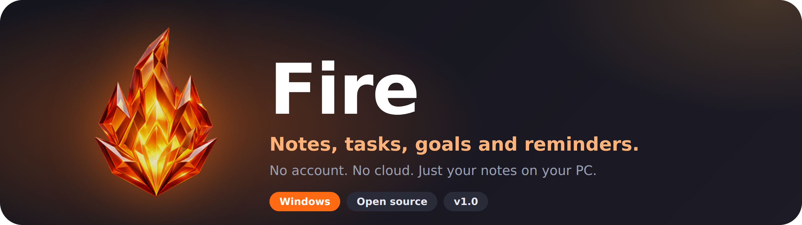
</p>

<p align="center">
  
  
  
  
</p>

<p align="center">
  <b>Fire</b> is a fast, good-looking notes app for Windows with tasks, goals and reminders.<br>
  No account. No cloud. Everything stays on your PC.
</p>

<p align="center">
  <a href="#screenshots">Screenshots</a> ·
  <a href="#features">Features</a> ·
  <a href="#your-data-is-yours">Your data</a> ·
  <a href="#get-fire-running">Run and build</a> ·
  <a href="#about-the-maker">Maker</a>
</p>

<p align="center">
  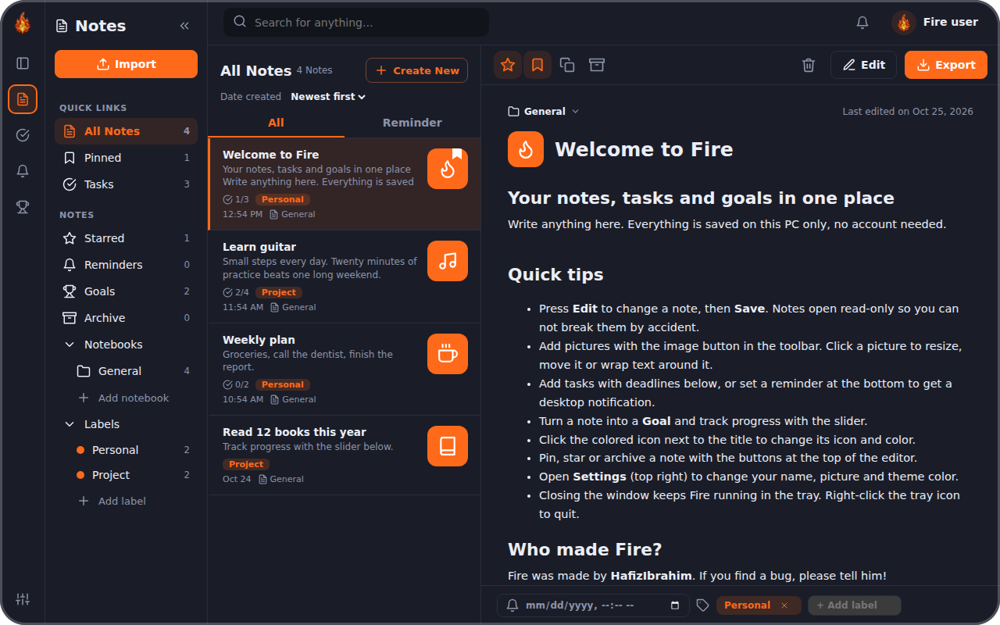
</p>

<a name="screenshots"></a>
<p align="center">
  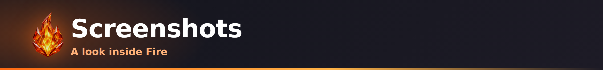
</p>

<p align="center">
  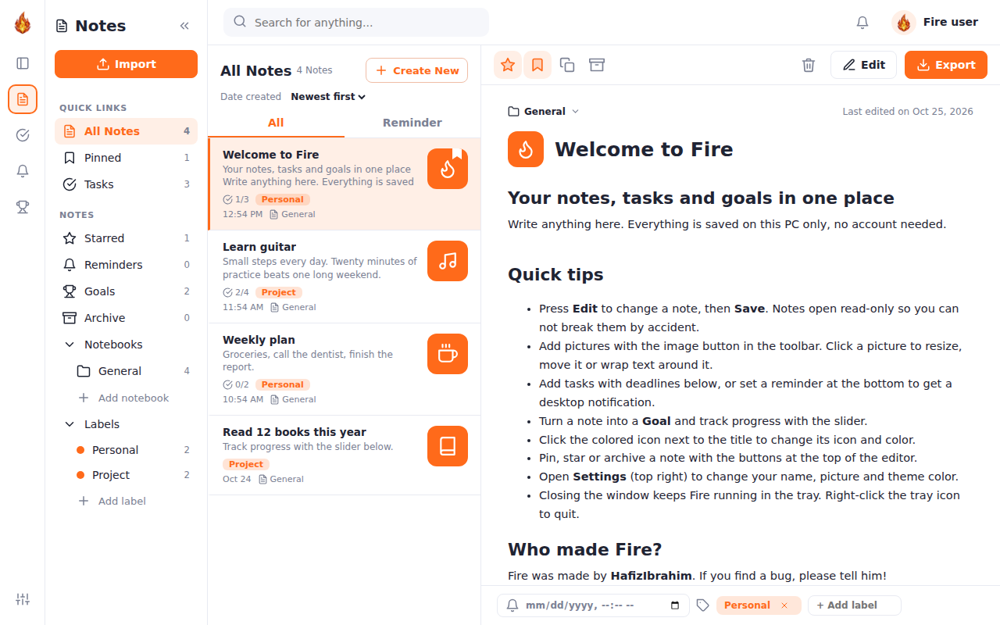
  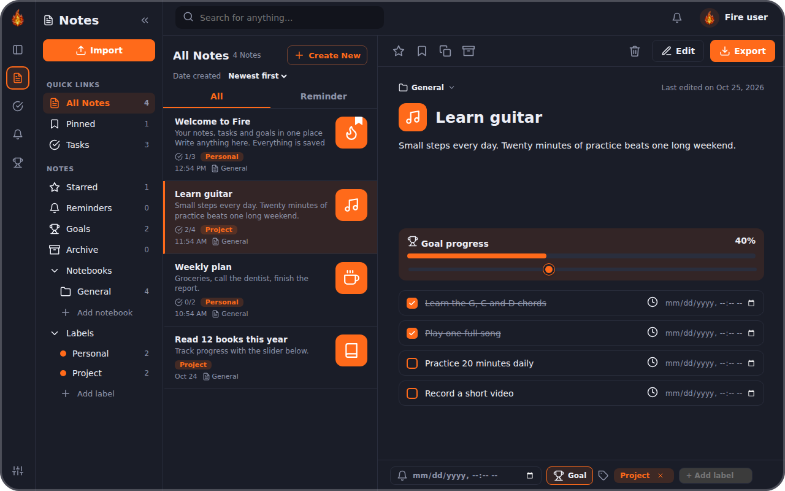
</p>
<p align="center">
  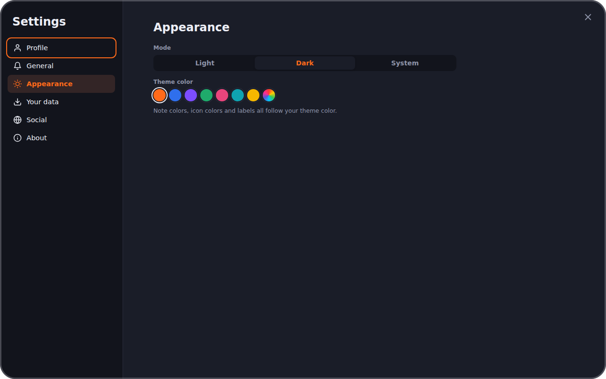
  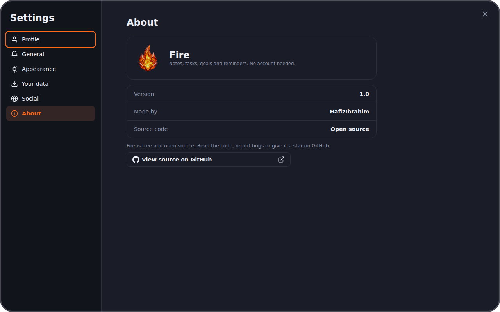
</p>
<p align="center">
  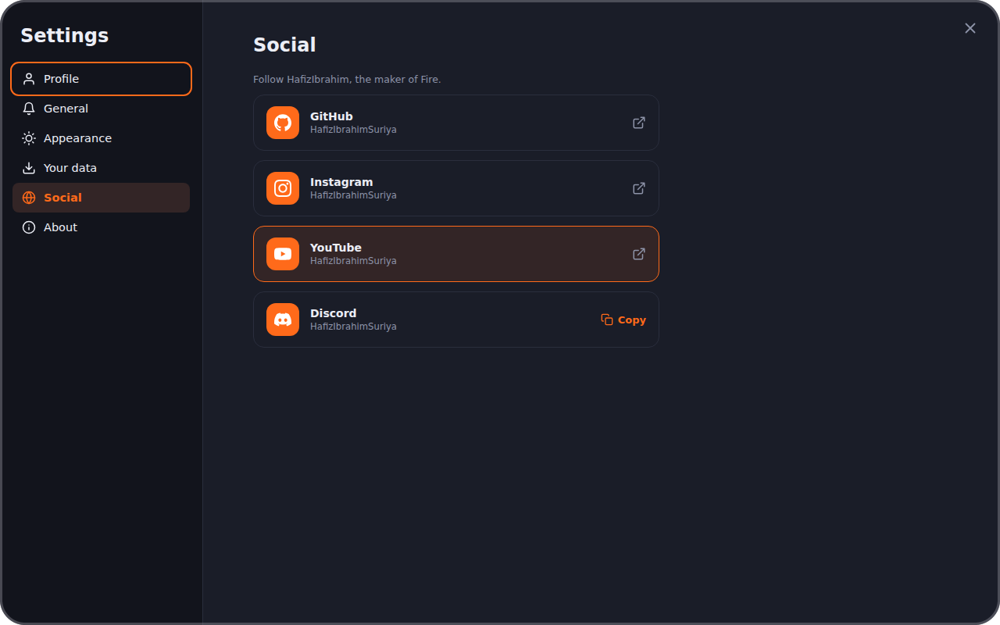
</p>

<a name="features"></a>
<p align="center">
  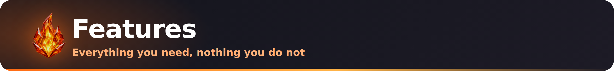
</p>

<p align="center">
  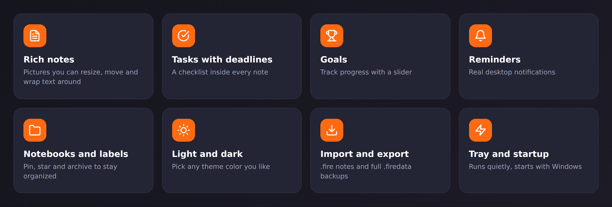
</p>

- **Notes** with rich text and pictures you can resize, move and wrap text around
- **Tasks** inside every note, each with its own deadline
- **Goals** with a progress slider, so you can see how far along you are
- **Reminders** that show a real desktop notification
- **Notebooks, labels, pin, star and archive** to keep everything organized
- **Custom note icons and colors**: click the icon next to the title to change it
- **Light, Dark or System theme** and any theme color you like (orange by default)
- **Tray icon**: closing the window keeps Fire running quietly; right-click the tray to open, add a note or quit
- **Start with Windows** (optional): Fire opens hidden in the tray
- **Read-only by default**: press *Edit* to change a note and *Save* when you are done, so nothing changes by accident
- **Search** across all your notes
- **Import and export** single notes (`.fire`) or a full backup (`.firedata`)
- **Trash**: deleted notes are moved to a Trash folder, not erased
- **About and Social tabs** in Settings with the app version, the source code and the maker's links

<a name="your-data-is-yours"></a>
<p align="center">
  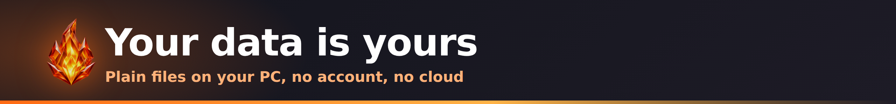
</p>

Fire saves everything on your computer, in `Documents\Fire`:

```
Documents\Fire
├── settings.json        theme, notebooks, labels, your name and picture
├── Notes\
│   └── <Notebook>\      one .fire file per note
└── Trash\               deleted notes end up here
```

Every note is its own plain `.fire` file (JSON), so you can back them up, sync them with any tool you like, or open them in a text editor.

<a name="get-fire-running"></a>
<p align="center">
  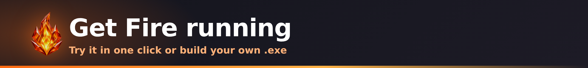
</p>

You need [Node.js](https://nodejs.org) installed.

**Try it without building**

```bash
git clone https://github.com/HafizIbrahimSuriya/Fire-NoteMaker.git
cd Fire-NoteMaker
npm install
npm start
```

On Windows you can also just double-click **`run.bat`**.

**Build the .exe (every Windows type)**

Double-click **`build.bat`**. It builds one app for each Windows type into the `dist` folder:

| Your PC | Also called | File | Notes |
| --- | --- | --- | --- |
| 64-bit Intel/AMD | x64, x86_64, AMD64 | `Fire-x64.exe` | The modern standard. Pick this one if you are not sure. |
| 32-bit Intel/AMD | x86, i386, IA-32 | `Fire-x86.exe` | Old PCs. Also runs on 64-bit Windows, but is limited to 4 GB of RAM. |
| 64-bit ARM | ARM64, AArch64 | `Fire-arm64.exe` | Snapdragon laptops, Surface Pro X and other ARM Windows PCs. |
| 32-bit ARM | ARM | not available | Windows RT and Windows Phone only. Electron has no build for it. |

Want only the normal 64-bit version, faster? Double-click **`build-x64.bat`** or run `npm run build:x64`.

Fire needs **Windows 10 or newer**. 32-bit ARM (Windows RT and Windows Phone) is not supported, because Electron does not make builds for it and those devices cannot run desktop apps anyway.

If you see a "symbolic link" error, right-click `build.bat` and choose **Run as administrator**. The first build downloads extra parts for the 32-bit and ARM64 versions, so you need internet.

**Project structure**

```
Fire-NoteMaker
├── main.js        Electron main process: window, tray, notifications, saving notes
├── preload.js     safe bridge between the app and the main process
├── src/           the app itself (index.html, app.js, style.css)
├── assets/        logo and icons
├── build/         installer icons
├── docs/          README images
├── run.bat        start Fire without building
├── build.bat      build Fire for x64, x86 and ARM64
└── build-x64.bat  build only the 64-bit Intel/AMD version
```

<a name="about-the-maker"></a>
<p align="center">
  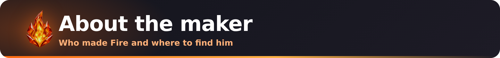
</p>

Fire was made by **HafizIbrahim**, a vibe coder. If you find a bug or have an idea, please open an issue, and be kind.

<p align="center">
  <a href="https://github.com/HafizIbrahimSuriya"></a>
  <a href="https://instagram.com/HafizIbrahimSuriya"></a>
  <a href="https://www.youtube.com/@HafizIbrahimSuriya"></a>
  
</p>

**Contributing:** Fire is open source. Fork it, change it, and send a pull request. Bug reports and ideas are welcome in the [Issues](https://github.com/HafizIbrahimSuriya/Fire-NoteMaker/issues) tab.

<p align="center">
  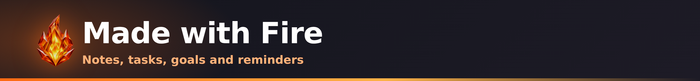
</p>
