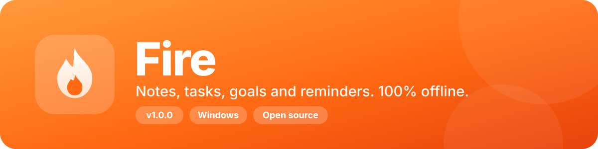

<div align="center">



<br>

[](https://github.com/HafizIbrahimSuriya/Fire-NoteMaker/releases/latest)
[](#-download)
[](https://www.electronjs.org)
[](LICENSE)
[](#-your-data-is-yours)

**Fire** is a fast, good-looking notes app for Windows with tasks, goals and reminders.
<br>No account. No cloud. Everything stays on your PC.

[⬇️ Download](#-download) · [📸 Screenshots](#-screenshots) · [✨ Features](#-features) · [🔒 Your data](#-your-data-is-yours) · [🛠️ Build](#%EF%B8%8F-run-and-build) · [👤 Maker](#-about-the-maker)

</div>

---

## ⬇️ Download

Get the latest version from the **[Releases page](https://github.com/HafizIbrahimSuriya/Fire-NoteMaker/releases/latest)**.

| Your PC | File | Notes |
|---|---|---|
| 💻 64-bit Intel/AMD | `Fire-x64.exe` | The modern standard. **Pick this one if you are not sure.** |
| 🖥️ 32-bit Intel/AMD | `Fire-x86.exe` | Old PCs. |
| 📱 64-bit ARM | `Fire-arm64.exe` | Snapdragon laptops, Surface Pro X. |

Requires **Windows 10 or newer**. See the [v1.0.0 release notes](docs/RELEASE_NOTES_v1.0.0.md).

---

## 📸 Screenshots

<div align="center">

<!-- Shows the dark screenshot on GitHub dark theme and the light one on light theme -->
<picture>
  <source media="(prefers-color-scheme: dark)" srcset="docs/notes-dark.png">
  
</picture>

<br><br>


</div>

> 💡 Screenshots with square corners? Run `python docs/round-corners.py` to round them (see the script for details).

---

## ✨ Features

| | Feature | What it does |
|---|---|---|
| 📝 | **Notes** | Rich text, with pictures you can resize, move and wrap text around |
| ✅ | **Tasks** | Inside every note, each with its own deadline |
| 🎯 | **Goals** | A progress slider shows how far along you are |
| ⏰ | **Reminders** | Real desktop notifications |
| 🗂️ | **Organize** | Notebooks, labels, pin, star and archive |
| 🎨 | **Icons and colors** | Click the icon next to the title to change it |
| 🌗 | **Themes** | Light, Dark or System, with any theme color (orange by default) |
| 🔔 | **Tray icon** | Closing the window keeps Fire running quietly. Right-click the tray to open, add a note or quit |
| 🚀 | **Start with Windows** | Optional. Fire opens hidden in the tray |
| 🔒 | **Read-only by default** | Press *Edit* to change a note and *Save* when done |
| 🔍 | **Search** | Across all your notes |
| 📦 | **Import and export** | Single notes (`.fire`) or a full backup (`.firedata`) |
| 🗑️ | **Trash** | Deleted notes move to a Trash folder, not erased |
| ℹ️ | **About and Social** | App version, source code and the maker's links in Settings |

---

## 🔒 Your data is yours

Fire saves everything on your computer, in `Documents\Fire`:

```
Documents\Fire
├── settings.json        theme, notebooks, labels, your name and picture
├── Notes\
│   └── <Notebook>\      one .fire file per note
└── Trash\               deleted notes end up here
```

Every note is its own plain `.fire` file (JSON), so you can back them up, sync them with any tool you like, or open them in a text editor.

---

## 🛠️ Run and build

You need [Node.js](https://nodejs.org) installed.

### ▶️ Try it without building

```bash
git clone https://github.com/HafizIbrahimSuriya/Fire-NoteMaker.git
cd Fire-NoteMaker
npm install
npm start
```

On Windows you can also double-click **`run.bat`**.

### 📦 Build the .exe

Double-click **`build.bat`**. It builds one app for each Windows type into the `dist` folder:

| Your PC | Also called | File |
|---|---|---|
| 64-bit Intel/AMD | x64, x86_64, AMD64 | `Fire-x64.exe` |
| 32-bit Intel/AMD | x86, i386, IA-32 | `Fire-x86.exe` (limited to 4 GB RAM) |
| 64-bit ARM | ARM64, AArch64 | `Fire-arm64.exe` |

Want only the normal 64-bit version, faster? Double-click **`build-x64.bat`** or run `npm run build:x64`.

> ⚠️ **32-bit ARM** (Windows RT, Windows Phone) is not supported. Electron has no build for it.
>
> If you see a "symbolic link" error, right-click `build.bat` and choose **Run as administrator**. The first build downloads extra parts for the 32-bit and ARM64 versions, so you need internet.

<details>
<summary><b>📁 Project structure</b></summary>

```
Fire-NoteMaker
├── main.js        Electron main process: window, tray, notifications, saving notes
├── preload.js     safe bridge between the app and the main process
├── src/           the app itself (index.html, app.js, style.css)
├── assets/        logo and icons
├── build/         installer icons
├── docs/          banner, screenshots, changelog and release notes
├── run.bat        start Fire without building
├── build.bat      build Fire for x64, x86 and ARM64
└── build-x64.bat  build only the 64-bit Intel/AMD version
```

</details>

---

## 👤 About the maker

Fire was made by **HafizIbrahim**, a vibe coder. If you find a bug or have an idea, please open an issue, and be kind.

[](https://github.com/HafizIbrahimSuriya)
[](https://instagram.com/HafizIbrahimSuriya)
[](https://www.youtube.com/@HafizIbrahimSuriya)
[](https://github.com/HafizIbrahimSuriya/Fire-NoteMaker)

## 🤝 Contributing

Fire is open source. Fork it, change it, and send a pull request. Bug reports and ideas are welcome in the [Issues](https://github.com/HafizIbrahimSuriya/Fire-NoteMaker/issues) tab.

## 📄 License

Released under the [MIT License](LICENSE).

<div align="center">

<br>

Made with 🔥 by [HafizIbrahimSuriya](https://github.com/HafizIbrahimSuriya)

</div>
